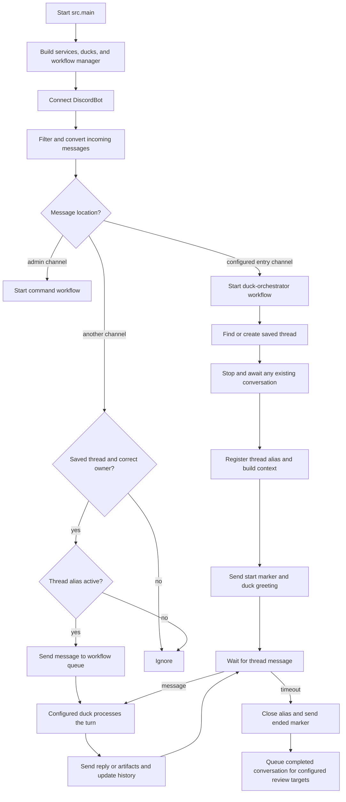
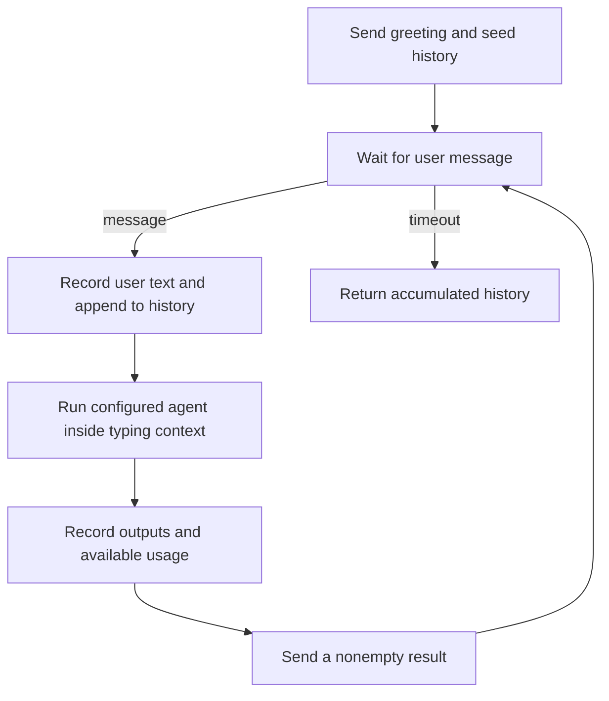
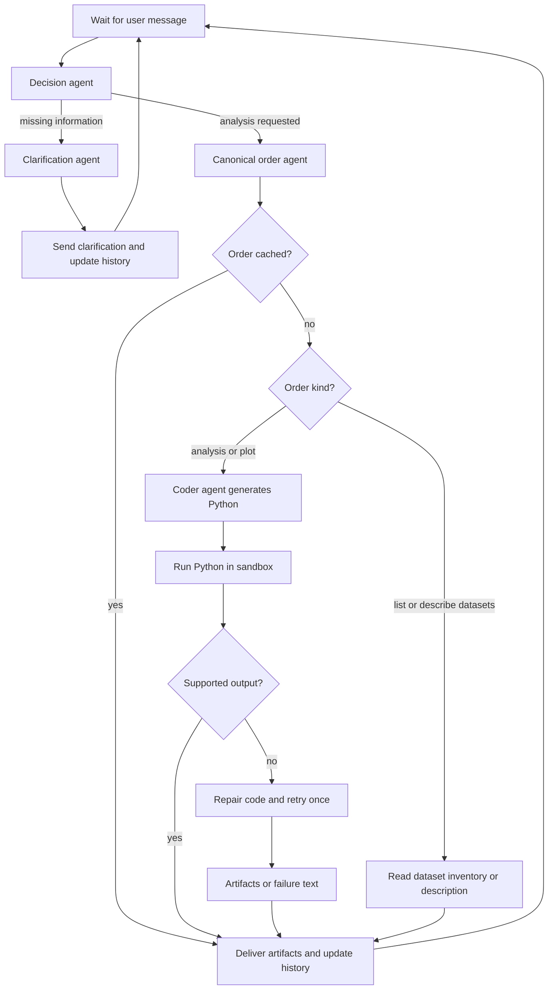

# Application flow

This is a source walkthrough of application startup, message routing, and the
Standard and Stats conversation workflows. It describes the current code;
it is not evidence that live Discord behavior or crash recovery has been tested.
Evaluation tooling and its proposed test drivers are described separately in
the [evaluation design](../evaluation/docs/evaluation-design.md).

## Overview



The router selects a workflow destination. The orchestrator owns thread setup,
conversation replacement, and lifecycle. Each production duck owns its turn
logic. Entry-channel messages start conversations; Standard and Stats wait for
a subsequent thread message before answering a question.

## Startup and configuration

```bash
poetry run python -m src.main --config path/to/config.yaml
```

`src.main` loads environment/configuration, config includes, logging, and the
shared services: SQL session, `ResponsesAPI`, `DiscordBot`, metrics, saved-thread
storage, and configured Python execution containers.

Ducks are constructed through `builder: module:function`. The main wiring
supports named ducks and inline channel definitions; each builder receives
messaging, metrics, responses, containers, SQL, tool configuration, and the shared
feedback manager. Configured channel IDs map to the resulting duck instances.
Conversation-review definitions also specify `target_channel_ids`. Startup
constructs a persistent SQL-backed queue for each target entry channel and passes
those queues to the feedback manager.

The app then constructs `SetupConversationThread`, `DuckOrchestrator`, command
handlers, and the SQL-backed Quest workflow manager. `RubberDuckApp` receives the
admin channel, channel configurations, workflow manager, and conversation store.
It is attached to the Discord client before `bot.start(DISCORD_TOKEN)` runs.
Configured cache cleanup runs alongside the bot.

`--config` accepts a local or S3 config path. Without it, startup reads
`CONFIG_FILE_S3_PATH`. On Discord readiness the bot attempts to send **Duck online**
to the admin channel. The workflow-manager context is entered before the Discord
connection starts; the readiness log does not itself create the manager.

Source: [startup/builders](../src/main.py),
[config loader](../src/utils/config_loader.py),
[Discord client](../src/bot/discord_bot.py).

## Message filtering and routing

`DiscordBot.on_message` ignores its own messages, unapproved bots, and messages
beginning with `//`. Bots configured in `bot-friends` are allowed. Accepted
messages become plain records with guild, channel, author, opening/message ID,
content, and attachment metadata.

`RubberDuckApp.route_message` applies these rules:

| Message location | Action |
|---|---|
| Admin channel | Start a `command` workflow |
| Configured duck entry channel | Start a `duck-orchestrator` workflow with channel config and the message |
| Saved thread belonging to the author, with an active thread alias | Send the message to that workflow's `messages` queue |
| Anything else | Ignore |

The router does not create threads, cancel conversations, or inspect a duck's
internal stages. Entry-channel workflow IDs are
`duck-<channel-id>-<opening-message-id>`. Thread messages use the saved mapping
and `has_workflow(str(thread_id))` to find an active conversation. A saved thread
without an active workflow does not automatically start another conversation.

Source: [Discord conversion/filtering](../src/bot/discord_bot.py),
[router](../src/rubber_duck_app.py).

## Thread setup, restart, and identity

`DuckOrchestrator.__call__` selects the configured duck and serializes startup
for the same **guild + user + entry channel** within the process. It then:

1. Calls `SetupConversationThread` to find or create the saved thread.
2. Calls `stop_conversation(thread_id)` to await the prior conversation,
   cancelling it first unless it is already closing.
3. Registers the thread ID as a Quest alias and records the current task.
4. Builds `DuckContext` from the opener and channel settings.
5. Sends the start marker, uses its message ID as the conversation ID, and calls
   the selected production duck.

`SetupConversationThread` queries `SQLConversationStore` with the same owner
key. For a new mapping it creates a Discord thread, mentions the user, and saves
the mapping. Both new and reused threads get a join link in the entry channel.
The current creation title is a fixed string; it is not derived from the opener.

The orchestrator and thread helper use process-local locks. Saved mappings are
not checked for deleted Discord threads, and these locks are not coordination
across multiple bot processes.

The same configured duck instance can serve multiple conversations. Each new
Standard or Stats invocation starts fresh AI history, while Stats' instance
cache can survive between conversations.

| Identifier | Meaning |
|---|---|
| Entry-channel ID | Selects a configured duck |
| Thread ID | Reusable Discord conversation space and routing alias |
| Conversation ID | Thread start-marker message ID used by the duck's metrics and feedback; the opener ID remains a fallback if startup fails before the marker is sent |
| Workflow ID | One Quest-managed orchestrator execution |
| AI history | Per-invocation model inputs/outputs, distinct from Discord's visible history |

Source: [orchestrator](../src/duck_orchestrator.py),
[thread setup](../src/conversation/threads.py),
[saved-thread storage](../src/storage/sql_conversations.py).

## Standard Duck turns



Standard starts with **Hello! How can I help you today?** Its AI history is seeded
with a synthetic user **Hi** and that greeting. The entry-channel opener is
available in `DuckContext` but is not submitted as the first question.

Each actual thread turn appends the user's text and the agent's returned output
items. Assistant messages and function-call outputs are recorded in metrics;
available token usage is recorded separately. A nonempty result is sent to the
thread. Provider retry notifications use that thread as well.

The loop ends when waiting for another message times out. It has no Stats-style
decision/order/coder chain or model-selected conversation-completion command.

Source: [Standard workflow and builder](../src/workflows/standard_duck/standard_duck_workflow.py),
[provider/tool loop](../src/gen_ai/ai_responses.py),
[message queue wait](../src/utils/message_utils.py).

## Stats Duck turns



Stats sends its introduction and starts with empty AI history. Each user turn is
recorded and appended to history before the decision agent runs. If details are
missing, the clarification agent responds; empty clarification text causes
another clarification attempt. The next user message goes through decision again.

For an analysis request, the order agent returns validated structured data:
list datasets, describe a dataset, request a plot, or request an analysis.
Dataset listing/description uses the sandbox's inventory and metadata directly;
it does not call the coder. Analysis and plotting generate and execute Python.

Execution produces text, CSV tables, or image artifacts. An execution error or
absence of supported artifacts triggers one repair attempt using the previous
code and error. A second failure becomes user-facing failure text.

A canonical order is the key for the duck instance's in-memory result cache.
Equivalent orders can reuse cached artifacts across conversations served by
that instance. Delivery still runs for each request. User-visible result context
is added to AI history: text, table rows, or a description of a delivered image.
Metrics retain text/tables and image metadata, rather than image bytes.

Before fulfillment, Stats records whether the canonical key is already cached.
The SQL event includes the conversation ID, serialized key, timestamp, and hit
flag. This records the cache lookup, not successful execution or delivery.

Both ducks' message timeouts apply while waiting for another user message.
They are not overall deadlines for a model turn or sandbox execution.

Source: [Stats workflow and builder](../src/workflows/stats_duck/stats_duck_workflow.py),
[Python execution](../src/utils/python_exec_container.py).

## Completion, errors, and feedback

When a duck returns, the orchestrator closes its thread alias, sends
**This conversation has ended.**, and calls `remember_conversation` with the
conversation identifiers. It retains the Discord thread and visible history.

Restart cancellation is recognized by the explicit **conversation restarted**
reason and follows the same normal end-marker path. Other cancellation is
re-raised. A regular duck exception is logged and sends an error-code message;
if that send succeeds, the orchestrator proceeds to the end marker and feedback
callback. Outgoing-message failures can interrupt that path.

Feedback is queued only for entry channels listed in a conversation-review
definition's `target_channel_ids`. `main.py` constructs these persistent queues
in the SQL blob namespace `conversation-queues`; channels without a review target
are not queued. Feedback records retain whether the conversation ID refers to a
thread message, so review links also support the opener-ID fallback.

The conversation-review builder serves queued conversations in a reviewer thread.
For each conversation it links to the start, accepts a rating or skip reaction,
optionally collects a written explanation, and stores feedback against the
student conversation ID. A rating timeout requeues that conversation and ends the
review session. The session also ends when its configured queues are empty.

Source: [orchestrator](../src/duck_orchestrator.py),
[feedback manager](../src/metrics/feedback_manager.py),
[review workflow](../src/workflows/conversation_review/conversation_review_workflow.py).

## Commands, reactions, and persistence

Admin messages go to `BotCommands`. The first word selects `!help` or a configured
command; unknown commands get a help suggestion, and handler failures are logged
and receive an error reply.
`!stats-cache` exports recorded Stats cache lookups as CSV with
`timestamp`, `conversation_id`, `cache_key`, and `hit` columns (`t` or `f`).

Reactions are filtered separately. An approved reaction whose message ID is a
known workflow alias becomes an emoji/user event on that workflow's `feedback`
queue; unknown aliases are ignored.

SQL serves separate purposes: thread mappings, message/usage/feedback metrics,
Stats cache events, persistent review queues, and Quest workflow records/history.
Initial `create_all` calls create missing
tables; they do not migrate incompatible existing schemas.

The workflow manager uses SQL storage and the configured serializer. Current
`workflow_serializer` is `MasterSerializer({})`, with no application-specific
type serializers registered. Stats order fulfillment and result delivery are
not independently decorated Quest steps in the current source. Do not infer
exactly-once sandbox execution, image-byte persistence, or replay-safe delivery
from the presence of SQL history. Those behaviors require explicit validation.

Source: [commands](../src/commands/bot_commands.py),
[reaction routing](../src/rubber_duck_app.py),
[SQL workflow storage](../src/storage/sql_quest.py),
[serializer configuration](../src/storage/serializer.py),
[metrics storage](../src/storage/sql_metrics.py).
