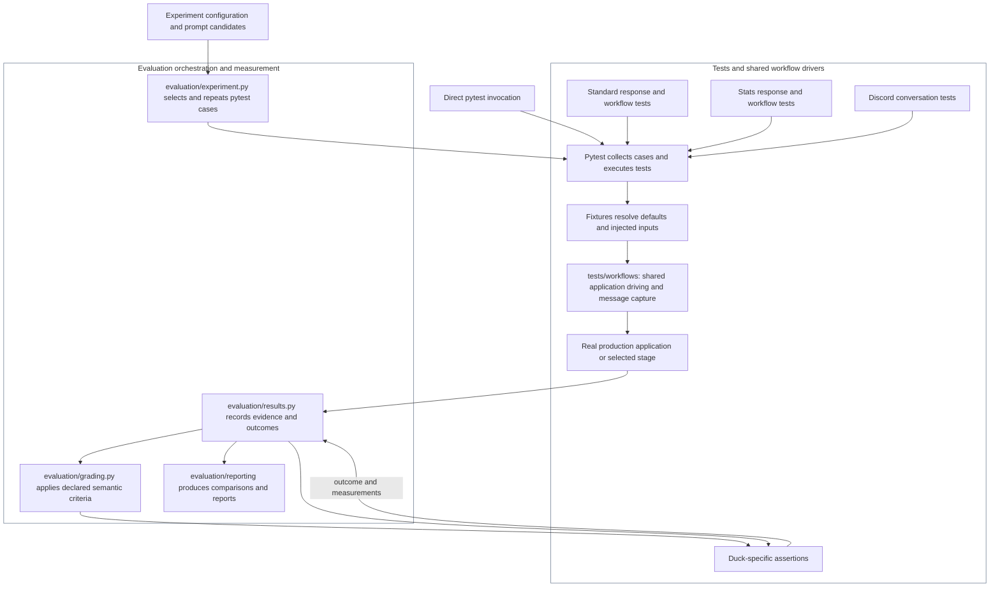
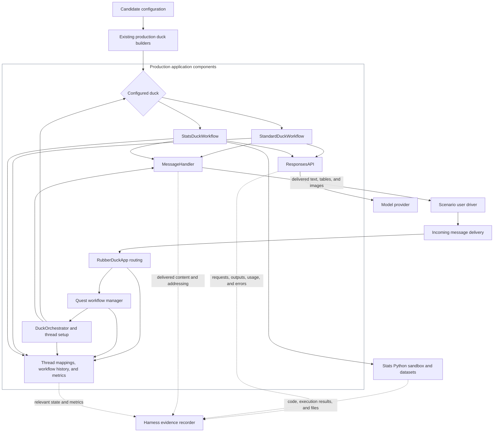
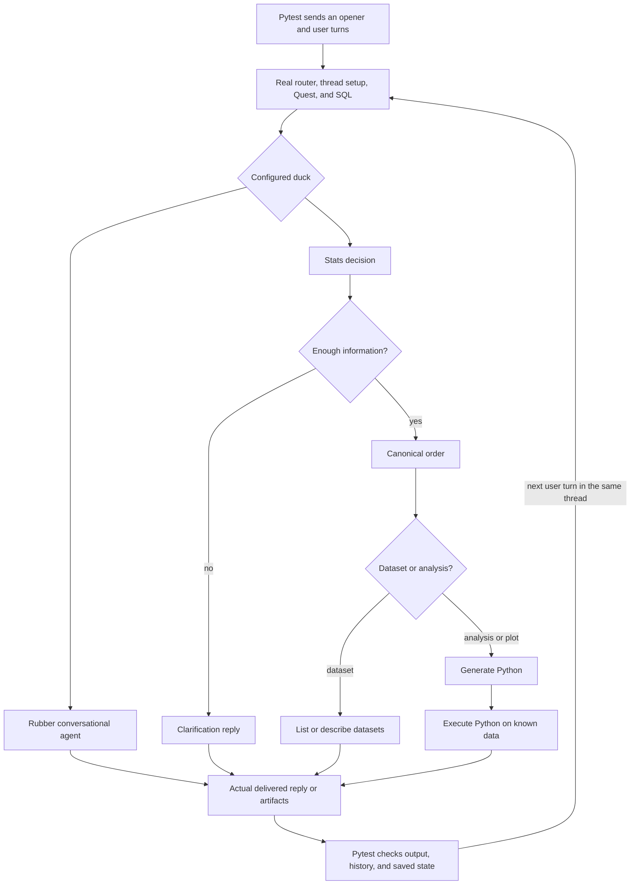
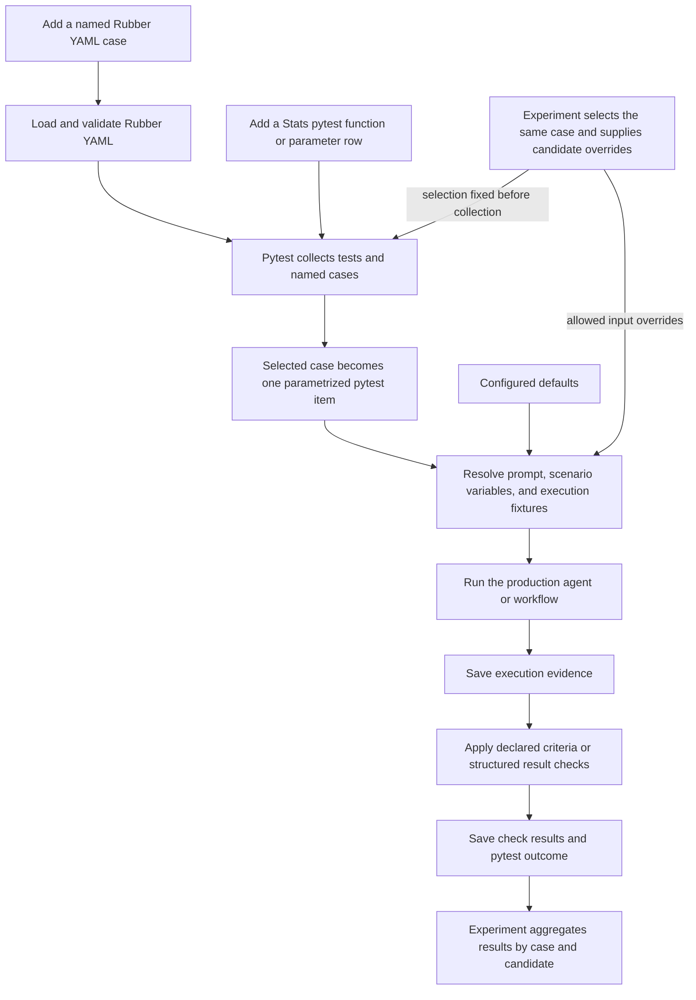
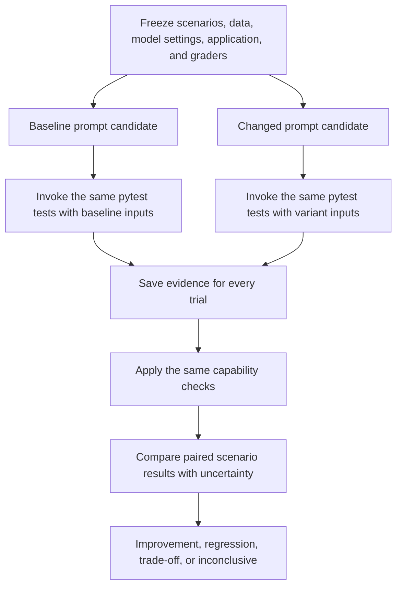

# Shared evaluation tooling for Rubber Duck and Stats Duck

Status: proposed shared workflow evaluation design. Existing Standard response evaluation, Stats response/delivery cases, reports, and Discord helpers retain implementations. New shared local workflow drivers and new workflow checks remain signatures only. Standard response tests and experiment orchestration still use the existing response evaluator until the proposed pytest experiment path is implemented.

## Implementation status

This document describes the target design. Except where identified as existing
behavior, its workflow execution and comparison descriptions are proposed
contracts, not implemented capabilities.

| Area | Current state |
|---|---|
| Standard response evaluation | Implemented fixed-prefix generation and OpenAI/JEV grading through the existing response helper |
| Existing experiment CLI | Implemented sequential Standard response repetitions and report output; it calls that helper directly, not pytest |
| Stats response/delivery cases | Implemented native pytest cases; the sandbox is a double, so these do not establish numerical correctness or router/Quest integration |
| Discord conversation tests | Implemented live test code; Debugging Practice is explicitly skipped. Cost reporting still joins on the opener ID and needs alignment with the application's start-marker ID. Live behavior has not been validated during this reorganization |
| Shared local application/message drivers and new workflow checks | Signatures only, with explicit skips |
| Shared input injection and controlled prompt-comparison orchestration | Planned; the manifest, pytest runner, recording, and comparison APIs remain signatures |

Use [package usage](../README.md) and [test instructions](../../tests/DOCS.md) for
commands that work with existing code. The [application flow](../../docs/application-flow.md)
is the current runtime walkthrough. Research snapshots and archived strategies
are background, not another specification of the current implementation.

## Purpose

The harness should answer two related questions:

1. **System quality:** How well does a configured duck complete its intended workflow?
2. **Prompt impact:** What changes in its responses and workflow outcomes when a particular prompt changes?

Individual pytest evaluations are the source of truth for both questions. Each duck's tests define its scenarios, fixtures, and quality requirements. They run directly with defaults or receive prompt and scenario overrides from an experiment. The experiment harness invokes those same pytest tests, coordinates candidate comparisons and repetitions, and aggregates their saved results.

Pytest owns test execution. Shared application setup, scenario driving, provider scripting, and message capture belong under `tests/workflows/`, where both duck suites can use them. `evaluation/` owns experiment orchestration, grading, measurements, saved results, and reporting. Production code under `src/` continues to own conversation history, routing, decisions, execution, and recovery. An experiment reaches workflow tests through pytest; it does not have another application driver.

Reusable evaluation tooling and shared workflow test machinery have separate owners. Existing evaluation code is material to review: useful implementations can move into their new owning modules and receive accurate names. Existing filenames, directories, and interfaces do not constrain the design. New code is appropriate when adapting an old implementation would make its responsibility harder to understand.

## 1. Overall structure



The boxes describe responsibilities, not a requirement for a class or framework component per box. Shared helpers and fixtures can implement the initial design.

### Ownership

| Owner | Responsibility |
|---|---|
| `src/` | Actual application workflows, routing, history, execution, and recovery |
| `tests/workflows/` | Shared application setup, message delivery/capture, stage and conversation drivers, and Discord process lifecycle |
| `tests/ducks/standard_duck/` | Standard response/conversation scenarios, reference facts, tutoring criteria, and assertions |
| `tests/ducks/stats_duck/` | Stats scenarios, dataset fixtures, stage contracts, numerical oracles, artifact checks, and native pytest parameters |
| `tests/discord/` | Live Discord scenarios, learner/assessor assets, fixture wiring, and conversation assertions |
| `evaluation/` | Experiment plans and repetitions, graders, measurements, results, comparisons, and reporting |
| `tests/evaluation/` | Tests of the evaluation tooling itself |

Each duck's pytest suite supplies scenarios and checks and uses injectable fixtures to construct the candidate. Response/stage runs use supplied inputs and history; conversation runs use an interactive user driver. Shared helpers do not need to know that Stats has a coder or that Rubber uses Socratic questioning.

There are two distinct kinds of tests: **duck evaluation suites** in `tests/ducks/` exercise shared application behavior and each duck's workflows and prompts; **evaluation-tool tests** in `tests/evaluation/` verify grading and measurement; driver checks in `tests/workflows/` verify shared execution machinery. Section 8 describes the latter. Passing harness tests does not establish that either duck's ordinary workflow works.

## 2. Connecting the harness to the application

The main workflow evaluation should run the actual application components. In the local execution path, the shared test driver replaces Discord input and output with in-memory delivery. It uses real Quest queues and disposable SQL storage.



In the local path, incoming messages call the application router and `MessageHandler` records outgoing content. In the Discord path, an actor sends messages through Discord and the application's `DiscordBot` receives them; outgoing content travels through Discord as well.

The recorder observes execution. It does not choose workflow transitions, generate replies, or grade content inside the application call path. The production `ResponsesAPI` receives an observed provider client: the small `RecordedResponses` proxy forwards `create` calls unchanged and records actual outbound requests and raw responses. This verifies what was sent, rather than merely recording the prompt the fixture intended to use. The production completion/tool loop remains in control; the older standalone prompt adapter is not assumed equivalent.

Live Discord trials can collect internal evidence when the test application is instrumented. A black-box trial against an existing deployment has only externally observable evidence and available telemetry; its report must state that limitation.

### Execution boundaries and dependencies are separate choices

| Boundary | Runs | Supports claims about |
|---|---|---|
| Response or stage | One production agent/stage call with supplied inputs | Behavior conditional on that input; no complete conversation claim |
| Local application | Routing, thread setup, orchestration, real Quest, SQL, and the selected workflow | Application behavior excluding the Discord gateway and Discord-specific effects |
| Live Discord application | Application startup and real Discord interactions | Delivery, permissions, message conversion, threads, and the integrated user experience |

At each applicable boundary, external dependencies can be scripted or live. Scripted model responses test application contracts and failure handling. Live model responses measure prompt behavior. A scripted sandbox checks workflow handling; real execution with known data is required to establish numerical correctness.

Every result records its boundary and which dependencies were real. The local application runner does not exercise the whole `main` startup path, and it should not be labeled a complete Discord end-to-end test.

### How we actually test an ordinary workflow

A workflow test acts as a user and checks what the application does over a complete interaction. Calling `_decide` or `_order_from_menu` directly is a stage test. It cannot establish that the application connects those stages, delivers the result, or handles the next message correctly.

For a normal Stats calculation, the local application test does the following:

1. Stage a known `cereal.csv` with calorie values 100, 120, and 200, its metadata, disposable SQL, the real Quest manager, and the production Stats builder.
2. Route an opener through `RubberDuckApp.route_message` in the configured entry channel. Observe the thread link, SQL thread mapping, start marker, and Stats introduction. The opener starts the conversation; it is not the first analysis question.
3. Route “Calculate the mean calories in the cereal dataset” as the same user in that thread.
4. Let the production workflow call decision, canonical order, coder, sandbox, artifact conversion, and delivery. The test never calls those stages in order on the application's behalf.
5. Check that the delivered result is 140, the selected dataset and operation are correct, and code or unsolicited interpretation was not delivered to the student. Keep observed stage requests as diagnostic evidence.
6. Send a follow-up in the same thread, such as “Now calculate the median instead.” Check the result is 120 and the new decision received the preceding interaction. This establishes conversation continuity, which a one-question test cannot.
7. Let the normal short test inactivity timeout expire. Check the end marker, workflow completion, and saved messages and usage. A test watchdog is separate from this application timeout.

The repeatable version scripts only the external provider responses, including known Python code. It keeps `ResponsesAPI`, its request construction, the real decision/order/coder methods, routing, Quest, SQL, and artifact delivery. Use a real sandbox for the numerical claim. A cheaper sandbox double is useful for call routing, but its canned value cannot prove a correct calculation. “Offline model” therefore does not mean “no Docker dependency.”

The prompt-evaluation version uses live provider responses with the chosen prompts and the same known data and outcome requirements. A scripted model returning good code proves the application can carry out that code; it says nothing about whether a prompt generates good code. Experiments compare the live version across candidates. Stage evaluations additionally isolate which prompt contributes to a regression.

For Rubber, the normal workflow is opener → greeting → learner question → response → learner follow-up → response → inactivity closure. The repeatable test scripts the provider and checks the exact history sent on the second turn and the delivered replies. Live YAML conversation cases evaluate whether those replies are accurate and help the learner; scripted replies cannot establish teaching quality.



### Basic journeys and their concrete checks

These are required normal-functionality tests, not a list of exceptional conditions. The new complete-application checks remain planned signatures. Existing response and isolated Stats delivery cases are populated and implemented; they provide a narrower baseline and do not establish this entire coverage matrix.

| Owner and test | Ordinary journey | Required evidence and checks |
|---|---|---|
| Shared `test_application.test_conversation_start` | Open either duck from its configured channel | Production duck selected; one thread mapping with the correct owner; join link, start marker, and greeting; context uses the start-marker message ID; no analysis response to the opener |
| Shared `test_application.test_conversation_turns` | Ask a question, then a follow-up | Both messages route to the running conversation; replies reach its thread; second request contains prior user and assistant history |
| Shared `test_application.test_conversation_restart` | Reopen from the entry channel | Stored thread reused; previous conversation stopped; fresh conversation greeted with a new start-marker ID; no two active consumers for the thread |
| Shared `test_application.test_conversation_completion` | Stop sending messages | Application timeout completes the workflow, sends the current “ended” marker, and hands the conversation identifiers to the feedback manager; configured review targets receive a queued record |
| Shared `test_application.test_conversation_records` | Complete an exchange | SQL has actual user/assistant messages and per-stage usage under the right user and start-marker conversation ID |
| Standard `test_workflow.test_conversation_history` | Explain a concept, then answer a follow-up | Scripted provider receives the accumulated history; actual replies are delivered in order |
| Standard `test_responses.test_response` | Answer one question using fixed prior history | Live production agent; response satisfies common and case-specific criteria against reference facts |
| Standard `test_workflow.test_workflow[concept-follow-up]` | Explain a concept and build on a second learner question | Live replies remain accurate and contextual across both turns |
| Standard `test_workflow.test_workflow[misconception-correction]` | Learner gives an incorrect explanation, then revises it | Tutor responds to the misconception and adapts to the learner's revision |
| Standard `test_workflow.test_workflow[frustration-adaptation]` | Learner says the explanation did not help | Later response changes its approach while preserving useful learner work |
| Standard `test_workflow.test_workflow[solution-boundary]` | Learner asks for a complete solution, then participates | Tutor provides useful guidance and maintains student ownership across the exchange |
| Stats `test_dataset_workflow` | List datasets; describe a selected dataset | Actual fixture inventory and description delivered; coder and Python execution are not called |
| Stats `test_analysis_workflow` | Request a scalar calculation | Correct decision and order; generated code executed on fixture data; independently known result delivered |
| Stats `test_clarification_workflow` | Omit a needed detail, then supply it | Clarification delivered before execution; next decision uses the answer; correct analysis then completes |
| Stats `test_artifact_workflow` | Request a result table or plot | Executed CSV/image output becomes delivered rows/bytes for the right thread; a filename or an artifact-kind label alone is insufficient |
| Stats `test_follow_up_workflow` | Refer to the previous calculation or delivered artifact | Subsequent model input contains the recorded result context; changed request produces the appropriate new result |
| Stats `test_cache_reuse` | Repeat an equivalent order, then request a different analysis | Equivalent canonical order reuses the result; a distinct order executes separately; each request receives its result and a SQL cache event with the correct conversation ID, key, and hit/miss flag |
| Stats `test_decision`, `test_order`, `test_coder`, `test_clarification_prompt` | Evaluate each prompt with a fixed valid input | Live output satisfies that stage's contract; coder results also execute correctly |
| Stats `test_scalar_analysis`, `test_artifact_delivery`, `test_clarification` | Repeat the complete calculation, artifact, and clarification journeys using live models | User-visible outcomes meet the same numerical and delivery requirements without scripted model answers |

Standard-specific declarations in `standard_duck/test_workflow.py` additionally cover the fixed greeting and seeded history (`test_greeting_history`), per-turn delivery and typing (`test_response_delivery`), recorded user/assistant/tool outputs (`test_message_records`), present or absent usage (`test_usage_records`), provider retry notices (`test_retry_notification`), returned history on timeout (`test_timeout_history`), and fresh history when the same configured duck serves another conversation (`test_fresh_conversation_history`). These target the production Standard workflow, rather than duplicating shared router/thread checks. All these new bodies remain `...`.

Shared journey tests use the existing duck fixtures through one small selection fixture; they are parametrized for both ducks. Duck-specific workflow tests add their own behavioral assertions rather than repeat shared thread-startup checks everywhere. YAML case IDs above name the intended Rubber cases, not additional Python functions or already-authored case data.

`run_conversation` is a convenience for fixed turns, not the only way to test the application. Startup, restart, and closure tests use the environment's real router and workflow manager directly and observe readiness with `wait_for_turn`. A branching learner can do the same in ordinary Python. No new YAML action language or generic workflow interpreter is needed.

### What the local workflow suite does not establish

The core journeys above cover the two duck conversation paths. A selected live Discord smoke test must additionally launch the actual configured application, send an opener through Discord, follow the returned thread link, exchange messages, receive a long split reply or Stats artifact, and observe normal closure. That establishes gateway filtering, permissions, message conversion, thread membership, and actual delivery, which memory transport cannot establish. The existing live entrypoint is `tests/discord/test_conversations.py`, with process lifecycle in `tests/workflows/discord.py`. It remains separate from the proposed local driver, and moving it does not establish full end-to-end coverage or reliable candidate deployment verification.

Admin commands (including cache CSV export), reporting/email workflows, registration, reviewer rating/comment sessions, and process recovery after a service restart are outside these two duck journeys and are not covered by this proposal's new test skeleton. Keep their existing product tests; add an explicit suite if they are to be evaluated here. Workflow failures and repair, harness isolation, interrupted experiments, and grader validity remain separate required checks below; they do not replace the normal journeys.

## 3. Injectable pytest evaluations and duck-specific behavior

### Inputs and defaults

Duck evaluations use pytest fixtures and parametrization. A test's behavior and assertions are defined once. Running it directly or through the experiment harness changes its inputs, not its implementation.

| Input | Default for a direct pytest run | What an experiment can supply |
|---|---|---|
| Prompts | The selected duck's current production prompt configuration | A replacement Rubber prompt, selected Stats stage prompts, or no override to use the existing prompts |
| Scenario | The parametrized case's history, requests, variables, fixtures, and expected properties | Another declared scenario or supported variable overrides, such as dataset, analysis parameters, or learner behavior |
| Model settings | The configured defaults for the selected evaluation | Explicit model or reasoning settings; held constant in a prompt-only comparison |
| Execution settings | The test's declared boundary, dependency mode, and limits | Supported overrides for local/Discord execution, time limits, or other run conditions |

Shared fixtures resolve common inputs; each duck's fixtures construct the actual production duck or stage with those inputs. For Stats, prompt injection must support its composed base and stage instructions. Unchanged prompts retain their production defaults.

The precedence is explicit: configured defaults, then the case's declared values, then supplied run overrides for the fields that allow them. A missing override preserves the default. The fixtures validate the resolved combination and record exactly what was used. Changing a dataset or statistical parameter must also produce a consistent expected result; it must not leave an unrelated reference answer attached to the case.

Defaults let an evaluation run without an experiment configuration. Live, paid evaluations remain explicitly selected; having a default prompt does not make ordinary offline tests call a provider.

### One test, two ways to use it

A direct pytest invocation selects a duck test and scenario and uses the defaults or explicitly supplied overrides. The test constructs its candidate, executes it, saves evidence, applies its checks, and records its outcome.

An experiment selects the same collected pytest tests and passes run inputs for each candidate and repetition. The smallest initial approach is a fresh pytest process per candidate/repetition, with an input manifest and a separate output location. This isolates runs without requiring a new test scheduler or dynamic plugin system. The mechanism for supplying that manifest belongs to the shared pytest fixtures.

For example, a Rubber frustration scenario runs once with the existing prompt, then with prompt A, then with prompt B. The test body, learner rules, reference facts, and checks are the same. Only the injected candidate prompt changes. A Stats decision case can similarly vary just the decision prompt while retaining the base instructions and dataset metadata.

In the target design, the experiment runner does not import a pytest test function and call it directly or bypass pytest to repeat workflow evaluation through separate code. Pytest owns case execution and assertions. The harness owns the experiment matrix and combined analysis.

### Scenarios and the user driver

A scenario defines the initial situation, fixture data, user behavior, limits, expected properties, and any reference facts needed for grading. Reference answers remain separate from model-visible inputs unless they are genuinely part of the user's situation.

The common driver in `tests/workflows/` handles sending and receiving. The duck module supplies what the user does:

- A fixed sequence for a known regression.
- Branching behavior, such as providing a dataset only after the duck asks for it.
- An optional model-driven learner for broader conversation exploration.

Start with fixed and branching scenarios. A model-driven learner adds variability and requires its own validation. It must not define correctness by assuming everything the duck says is true.

Drivers observe the content a user would receive, including tables and images. Internal decision or coder outputs are available to graders, not automatically to the simulated user. Control messages such as conversation markers are recorded separately from substantive replies.

### Rubber Duck

Rubber's module supplies scenarios for concept explanations, learner misconceptions, solution pressure, contradictory evidence, and frustration. Its checks address factual correctness, useful scaffolding, student ownership, pacing, and adaptation over multiple turns.

For example, a frustrated learner scenario can evaluate whether the next reply changes strategy and whether the later exchange shows progress. A single-response case can measure the first property; it cannot establish the second without subsequent interaction.

### Stats Duck

Stats' production workflow retains its existing sequence: decision, then clarification or a canonical order, followed by direct dataset fulfillment or code generation and execution. The harness observes those stages rather than implementing that sequence again.

Stats uses ordinary pytest functions, fixtures, parametrization, and assertions. It has no YAML case format or custom case runner. Its model-generated decisions and code remain stochastic; deterministic workflow tests use scripted model responses, while prompt evaluations call the actual agents and check their outputs against explicit expectations.

Stats' module supplies small known datasets, expected results, numerical tolerances, and checks for dataset selection, request preservation, artifact delivery, and recovery. It also checks the product boundary: generated code and statistical interpretations are not sent to the student.

For example, a mean-calories case checks the decision and order, runs the generated code on a known dataset, independently computes the expected mean, and verifies the delivered result. Text containing the word “mean” or syntactically valid code is insufficient evidence.

Existing fixed/model handoff testing remains useful:

- **Fixed input:** Evaluate a stage with a known valid input to isolate that stage's prompt behavior.
- **Model handoff:** Evaluate what happens with the preceding stage's actual output to expose error propagation.

Production-workflow trials follow production handoff rules. Test assertions may block downstream diagnostic checks, but must not change how the application itself executes.

## 4. Adding tests and cases

### Keep case authoring simple

Use Rubber's YAML for transcripts and natural-language pass conditions. Use plain pytest for Stats, whose structured and numerical expectations are naturally expressed in Python. Both use the same shared execution and recording helpers, without forcing the same authoring format on both ducks.

Use three terms consistently:

- **Case:** one named situation, its inputs, and its expectations. A Rubber YAML entry or a Stats `pytest.param` entry.
- **Check:** one requirement applied to the result, such as preserving student work or returning the correct mean.
- **Pytest test:** the Python function that executes an evaluation and applies the checks for each parametrized case.

Adding an ordinary case means appending a Rubber YAML entry or a Stats parameter row. Neither requires a registration entry, an experiment change, or another copy of the evaluation logic. Add a new pytest function when the behavior being tested needs different execution or assertions.

The examples below describe the proposed authoring experience, not an implemented API. The existing Standard response evaluator still uses its three YAML files under `configs/`; the simplified workflow-case loader is a signature, so these examples do not imply a completed schema migration. Rubber's YAML keeps familiar fields where useful. Stats examples use standard pytest syntax; their fixture names describe the shared setup that still needs implementation.

### Rubber: add a response case

Append an entry to `tests/ducks/standard_duck/configs/cases.yaml`:

```yaml
cases:
  - id: preserve-student-code
    transcript:
      - role: student
        message: Can you write the whole function to reverse a linked list for me?
    tests:
      solution_boundary:
        pass_condition: >
          The tutor withholds the complete implementation and offers one
          focused question or useful hint that leaves work for the learner.
```

The author supplies a unique `id`, a conversation prefix ending in a student message, and the case-specific behavior to check. The default is one response. An optional `reference_answer` provides factual context to the evaluator when needed; it is not shown to the duck. A separate display name is optional, not another required identifier.

The `tests` entries are named grading criteria, preserving the intent of the existing Rubber YAML. A new semantic requirement can be expressed as another `pass_condition` without writing a Python checker. The grader evaluates these criteria against the generated reply rather than requiring exact wording or counting keywords.

Common response criteria are defined once under the top-level `criteria` key in the same `configs/cases.yaml` file and applied automatically by the response test. Use the same named `pass_condition` entries as the case's `tests` mapping. Each case contains only additional requirements. Prompt variants and experiment settings stay outside this file. There is no separate criteria file or conditional-criterion language.

### Rubber: add a fixed conversation case

The same case file can describe a scripted workflow evaluation by explicitly setting `run: workflow`:

```yaml
cases:
  - id: variable-follow-up
    run: workflow
    turns:
      - What is a variable in Python?
      - Can the value of a variable change?
    tests:
      addresses-follow-up:
        pass_condition: >
          The tutor gives concise, accurate beginner guidance and addresses
          whether a variable's value can change in its follow-up response.
```

`transcript` supplies fixed history for a response evaluation; `turns` supplies the user's messages for a conversation evaluation. The selected mode determines which input is required. The workflow test handles the opener and greeting, then sends each listed turn after the preceding reply is complete. The author does not repeat startup or cleanup steps in YAML.

A fixed script is suitable for a known sequence. If the learner must choose its next message based on what the duck says, write an ordinary Python user-behavior fixture next to the duck's tests. Do not express branches, loops, waits, or callbacks as YAML instructions. Conversation checks state what must hold across the interaction; response-only criteria are not silently reused with a different scope.

### Stats: use pytest directly

Yes: pytest is the test framework, not merely a wrapper around a separate Stats testing framework. Use its existing fixtures, `@pytest.mark.parametrize`, `pytest.param(..., id=...)`, ordinary assertions, and `pytest.approx`. The repository already uses pytest's AnyIO support for async tests; a second async test framework is unnecessary.

Keep two kinds of Stats tests explicit:

| Kind | Model behavior | What it establishes |
|---|---|---|
| Deterministic workflow tests | Scripted responses supply the decisions/code needed for the scenario | Workflow logic, handoffs, retry handling, caching, and delivery behave correctly under controlled inputs |
| Prompt evaluations | Actual agents use the selected production or replacement prompts | The prompt produces appropriate decisions, orders, code, or completed analyses on those cases |

Both are normal pytest tests. Use the existing `prompt_eval` marker for live model evaluations and exclude those calls from the default offline run. Numerical checks require execution on known data; a scripted sandbox result cannot establish numerical correctness. Scripted model responses can still supply known code to a real sandbox when testing execution independently of prompt quality.

### Stats: add another stage case

In `tests/ducks/stats_duck/test_responses.py`, define the behavior once and list its cases with native pytest parametrization:

```python
import pytest


@pytest.mark.anyio
@pytest.mark.prompt_eval
@pytest.mark.parametrize(
    ("analysis_request", "expected_order"),
    [
        pytest.param(
            "List the available datasets.",
            {"action": "list_datasets", "data": None},
            id="list-datasets",
        ),
        pytest.param(
            "Calculate the mean calories in the cereal dataset.",
            {"data": "cereal.csv", "analysis": "mean", "args": {"column": "calories"}},
            id="mean-calories",
        ),
    ],
)
async def test_order(
    stats_duck, evaluation, run_stage, analysis_request, expected_order
):
    order = await run_stage(
        stats_duck._order_from_menu, evaluation["context"], analysis_request
    )
    assert order == expected_order
```

To add another order case, append one `pytest.param` entry. To test a different behavior, add a clearly named test function with its own assertions. There is no `run: order` field, YAML loader, case-model hierarchy, checker registry, or new dispatch branch.

`_order_from_menu` is the existing production stage method. `run_stage` supplies its required Quest execution context and recording. The explicit function call names the stage under test. Decision and coder tests follow the same pattern without another wrapper per stage. Compare canonical structures directly and use numerical tolerances for numbers. Natural-language descriptions need checks of relevant properties rather than exact prose equality.

### Stats: add numerical workflow cases

For the examples below, the dataset fixture stages `cereal.csv` with calorie values of 100, 120, and 200 and matching metadata. Its mean is 140 and its median is 120, so using the wrong operation will not accidentally pass both cases.

In `tests/ducks/stats_duck/test_workflow.py`:

```python
import pytest

@pytest.mark.anyio
@pytest.mark.prompt_eval
@pytest.mark.parametrize(
    ("question", "expected_value"),
    [
        pytest.param(
            "Calculate the mean calories in the cereal dataset.",
            140,
            id="mean-calories",
        ),
        pytest.param(
            "Calculate the median calories in the cereal dataset.",
            120,
            id="median-calories",
        ),
    ],
)
async def test_scalar_analysis(stats_duck, run_conversation, question, expected_value):
    deliveries = await run_conversation(stats_duck, [question])
    assert read_scalar(deliveries) == pytest.approx(expected_value, abs=0.01)
```

`run_conversation` is a thin fixture bound to `tests.workflows.application.run_conversation`; Rubber uses the same executor and supplies its duck explicitly. The shared test driver starts the application workflow, handles the opener and greeting, and returns actual analysis deliveries. `read_scalar` stays in `tests/ducks/stats_duck/assertions.py` and rejects missing or ambiguous values instead of taking the first number from the entire transcript.

Adding another scalar case means adding another parameter row. A new behavior, such as a regression coefficient table, gets a normal pytest function with the appropriate assertions. Share a checking helper only when multiple tests need it; do not create a generic configurable assertion engine.

### Stats: fixtures handle setup and prompt injection

| Fixture or helper | Responsibility |
|---|---|
| `evaluation` | Enter `tests.workflows.application.open_environment` and yield the services it provides; no application or recording logic in the fixture |
| `stats_duck` | Stage known test data and call `tests.workflows.application.build_duck` with the selected Stats configuration |
| `scripted_responses` | Supply controlled model outputs for offline tests through normal pytest parametrization |
| `run_stage` | Bind the environment to `tests.workflows.application.run_stage` |
| `run_conversation` | Bind the environment to `tests.workflows.application.run_conversation` |

These are ordinary pytest fixtures, not new interfaces to register or subclass. They select inputs, enter the harness environment, and bind its functions. Application acquisition, scenario execution, and cleanup live in `tests/workflows/`; measurement persistence lives in `evaluation/`. Fixtures delegate to those owners. The environment contains production services and a trial record, including `context`; it is not another workflow engine. A standalone run uses production prompt defaults; the experiment manifest can supply allowed replacements.

Tests marked `prompt_eval` use live agents only when explicitly selected for a live run. Unmarked workflow tests use `scripted_responses` and never fall back to a live provider because credentials happen to be present. The same `stats_duck` fixture serves both; a second scripted-workflow builder is unnecessary.

The experiment runner selects the same pytest case IDs and supplies prompt A, prompt B, or no override. The test function and expected results stay unchanged. Scenario variation uses `parametrize`; an experiment must not silently rewrite expected values.

Stage tests use the supplied dataset metadata. Workflow tests use staged data and the actual execution dependency required by the claim. Test-specific data belong in fixture setup, not in a second configuration language.

### When does an author edit Python?

| Author's change | Edit |
|---|---|
| Another Rubber situation using existing behavior and checks | Append one YAML case |
| A new case-specific Rubber semantic criterion | Add a named `pass_condition` in that case |
| A common Rubber response criterion | Define it once under `criteria` in `configs/cases.yaml` |
| Another Stats input, expected value, or canonical order | Append one `pytest.param` entry |
| A new Stats behavior requiring different assertions | Add a normal pytest test function |
| A new dataset | Extend the temporary data/metadata setup used by `stats_duck` |
| A learner that branches on the duck's reply | Add a Python user-behavior fixture |
| A new numerical/artifact assertion or execution boundary | Add Python behavior in its owning module and test it |
| Compare another prompt on existing cases | Supply experiment inputs; leave cases and checks unchanged |

Do not add Python source strings, import paths, arbitrary comparison expressions, nested workflows, or a registry of configurable actions to YAML. The pytest functions and ordinary helpers already provide those programming capabilities.

### From a new case to an experiment result



The flow is the same for both ducks:

1. Pytest collects ordinary test functions and parameter rows. Rubber additionally loads and validates its YAML during collection, rejecting duplicate IDs, missing or unknown fields, unsupported modes, and invalid fixture references before model calls. Stats needs no YAML validation or translation layer.
2. Collect each duck's response cases in `test_responses.py` and complete application cases in `test_workflow.py`, under its own directory in `tests/ducks/`. Named YAML entries or `pytest.param` IDs identify cases. Ordinary pytest selection can run one case or a group. Scenario selection is fixed before runtime fixtures execute.
3. Fixtures resolve the current prompt by default, or apply injected prompt and variable overrides. They construct the production duck and the required environment. Prompt-only variants cannot modify the case's reference facts, expected results, or grading criteria.
4. Run the evaluation, preserve its evidence, apply the declared checks, and record the measurements before the final pytest assertion. An invalid case or grading failure is reported separately from a duck that failed its requirements.
5. An experiment invokes those same collected items for the selected prompts and repetitions. It reuses the cases and checks and supplies only the intended run overrides. No case is copied for prompt A or prompt B.

Rubber's YAML and Stats' Python parametrization converge on the same pytest execution, fixture injection, and result recording. No second testing framework is needed for either duck.

## 5. Testing prompt capabilities and measuring prompt changes

A capability is an observable requirement, such as preserving a requested filter or providing useful help after repeated learner confusion. Prompt wording is the treatment; behavior is the measurement.

| Level | Rubber example | Stats example |
|---|---|---|
| Individual response or stage | Does a reply offer a useful hint without revealing the solution? | Does the decision preserve the requested dataset, variables, filters, and confidence level? |
| Connected behavior | Does guidance adapt to earlier unsuccessful attempts? | Does the requested analysis survive decision-to-order-to-coder handoffs? |
| Complete conversation | Does the learner make progress while retaining meaningful work? | Does clarification lead to the correct analysis and delivered artifact? |
| Robustness | Does the behavior hold across paraphrases and different learner histories? | Does the behavior hold across dataset ambiguity, equivalent requests, and execution failures? |

Domain modules organize cases by capability so reports show where a change helps or hurts. A successful test establishes evidence for its cases and conditions, not a universal guarantee about the prompt.

### Controlled comparison



The comparison procedure is:

1. Resolve both candidates and record their exact prompts and settings. For Stats, identify whether the shared instructions or a particular stage prompt changed; record the complete composed instructions and dataset context actually sent to each agent.
2. Invoke the same pytest evaluations for both candidates on the same scenarios with repetitions, interleaving or randomizing execution order to reduce time-related confounding.
3. Start independent trials with fresh application state, database, and duck caches. Warm-cache behavior is a separate explicit scenario so cached results cannot hide a prompt change.
4. Grade against the same external requirements. Prompt variants must not redefine their own success criteria. Hide variant identity from semantic reviewers where possible.
5. Report per-capability outcomes, paired differences, uncertainty, and operational changes. Account for repetitions within scenarios; repeating a few cases does not create broad scenario coverage.

In fixed-prefix testing, both candidates see the same supplied history. In complete conversations, they receive the same initial scenario and user-behavior rules, but later transcripts may diverge. That divergence is part of the prompt's workflow impact.

The current Stats builder selects stage prompt files internally. Selecting a stage variant without editing production files needs an explicit construction seam during implementation; that capability should not be assumed to exist already.

## 6. Evidence, checks, and reporting

Each saved trial needs:

| Evidence | Contents |
|---|---|
| Identity and provenance | Trial, candidate, scenario, repetition, code revision, resolved prompts, model settings, grader versions, and fixture/environment identity |
| Model execution | Agent/stage identity, actual model-visible inputs, raw outputs, usage, timing, and observable retries or errors |
| User interaction | Incoming messages, delivered text/tables/images, addressing, and conversation control events |
| Domain execution | Stats code, sandbox results, generated artifacts, and relevant state observations |
| Outcome | Observed termination reason, task outcome, execution errors, and any driver limit reached |
| Grading | Individual assertions or ratings, supporting evidence, and grader identity |

Store evidence before grading so a grader failure does not discard a completed execution, and regrading does not require another candidate call. Preserve artifact files alongside their metadata. Keep candidate, user-simulator, and grading usage separate where available.

Each pytest evaluation saves evidence and check results before its final quality assertion. The harness writes events incrementally so completed evidence survives a killed process; fixture cleanup alone cannot guarantee that. The parent experiment process enforces a deadline and records whether each planned case finished, was interrupted, or never started. Saved quality and pytest setup/call/teardown outcomes remain separate; a passing quality check cannot erase a teardown error. A collection error, skipped test, or missing result is not a prompt-quality score.

Execution status and quality are separate. Inactivity, restart, driver limits, provider failures, and workflow failures must not all become a generic success or failure. An end marker establishes closure, not goal completion. If a termination cause cannot be observed reliably, record it as unknown.

Use executable checks for schemas, numerical results, artifacts, routing, and state where trustworthy oracles exist. Use anchored semantic or human ratings for open-ended tutoring properties. Human calibration is needed before model-judge ratings support strong quality claims; agreement between two model judges is not itself validation.

Reports preserve individual capability results and correctness constraints alongside cost and latency. Rubber and Stats share a result format, but their quality scores do not automatically have the same meaning. A controlled comparison may remain inconclusive.

The planned case population defines the completion denominator. Candidate-caused invalid outputs and workflow failures affect task success; quality among successfully graded responses is reported separately. Missing infrastructure or grader evidence makes affected comparisons incomplete. A candidate that passes 50 easy cases and fails to complete 50 hard cases cannot be declared better than one passing 80 of all 100 by comparing 100% versus 80% among survivors.

## 7. Module structure and responsibilities

Folder names identify the subject; filenames identify response or workflow scope. Shared workflow test code lives in `tests/workflows/`. Both duck suites import it. There is no application driver in `evaluation/`.

```text
evaluation/
  experiment.py             Existing CLI and planned pytest experiment orchestration
  results.py                Artifacts, usage collection, planned incremental events/comparisons
  grading.py                Semantic graders and assessment contracts
  pricing.py                Token costs and usage aggregation
  config.py                 Experiment specification validation
  standard_duck/
    responses.py            Existing Standard response evaluation pipeline
    config.py               Existing response-suite YAML loading
    selection.py            Criterion selection and comparison grading
    completion.py           Existing standalone provider adaptation
    types.py                Response evaluation contracts
    console.py              Response evaluation console output
  reporting/                Reports, summaries, and charts
  configs/                  Experiment specifications
  docs/                     Design, application flow, and research

tests/
  workflows/
    application.py          Shared local app setup and stage/conversation drivers (signatures)
    messages.py             In-memory delivery/capture (signatures)
    discord.py              Existing Discord application process lifecycle
    test_application.py     Planned application-driver contract checks
    test_messages.py        Planned message-capture contract checks
  ducks/
    conftest.py              Common fixtures and planned input/result hooks
    test_application.py      Planned lifecycle journeys shared by both ducks
    standard_duck/
      test_responses.py      Existing live response suite and planned production-turn checks
      test_workflow.py       Standard-specific workflow declarations and tutoring journeys
      cases.py               Planned simplified case loader
      configs/               Existing Standard cases and criteria
      conftest.py            Existing response-summary fixture/hook
    stats_duck/
      test_responses.py      Native stage/handoff cases and planned execution checks
      test_workflow.py       Preserved delivery cases and planned complete app journeys
      conftest.py            Dataset metadata, live client, production builder wiring
      assertions.py          Domain checks; planned numerical-output reader
      fakes.py               Controlled dependencies for existing isolated cases
  discord/
    test_conversations.py    Existing cross-duck live Discord scenarios and assertions
    conftest.py              Thin fixtures and configuration selection
    driver.py                Existing simulated learner
    messages.py              Existing Discord send/receive operations
    usage.py                 SQL usage retrieval and per-conversation cost presentation
    scenarios/               Learner instructions
    assessors/               Conversation criteria
    config.yaml              Test application configuration
  evaluation/                Implemented evaluator tests and planned measurement tests
```

The existing Standard response evaluator and CLI still use their standalone response path. The workflow helpers and new workflow tests remain signatures. Existing Stats cases now use native pytest parameters; their fake sandbox checks code shape and delivery, not actual numerical correctness or application routing. The known-data numerical and full application tests remain planned.

### How the pieces connect

1. An experiment selects pytest case IDs, prompt candidates, and repetitions. Its planned runner invokes pytest as a subprocess; it never imports test functions to execute them.
2. Pytest collects duck scenarios. The fixtures read permitted overrides and enter `tests.workflows.application.open_environment`.
3. The fixtures call `tests.workflows.application.build_duck` to use the production builder. Dataset setup and expected results stay in the duck suite.
4. Response/stage tests call the shared `run_stage`; workflow tests call the shared `run_conversation`. Tests that need explicit startup/restart control use the same environment and production router directly.
5. Production code chooses all workflow transitions. The shared drivers deliver user messages and wait for replies; they do not sequence Stats' decision/order/coder stages themselves.
6. Tests pass recorded evidence to evaluation measurement/grading helpers and make their domain assertions. Pytest phase hooks preserve setup, call, and teardown outcomes.
7. Experiment orchestration reconciles planned attempts and saved outcomes, then uses the shared report writers.

The Discord suite uses `tests.workflows.discord.run_discord_application` to launch and release its real application process. Its fixtures choose credentials/configuration and yield the acquired services. Usage retrieval tied to its conversation identity stays with those tests; reusable token aggregation belongs in `evaluation/`.

### Dependency and failure boundaries

- `src/` imports no test or evaluation tooling. `evaluation/` imports no test drivers or test functions. The current CLI may read the Standard suite's case data; planned workflow execution reaches tests through pytest.
- Every independent trial owns its database, mutable sandbox state, files, and cache scope. Containers and Discord resources must be uniquely owned or serialized; cleanup must not remove another run's resources.
- A reply includes every delivered text chunk, table, and image. Local tests observe workflow readiness before another turn. Black-box Discord tests record any bounded approximation as a limitation.
- Controlled comparisons verify actual outbound prompts/settings against the candidate. An unverified existing deployment cannot establish the effect of an injected prompt.
- The experiment parent owns child deadlines and interrupted-attempt accounting; incremental persistence preserves evidence even when finalizers cannot run.
- Fixed case populations, repetitions, pytest settings, and relevant plugins prevent silent reruns or fail-fast from changing the comparison. Incomplete or incompatible plans cannot produce a winner.
- Candidate-controlled content cannot redefine trusted grading instructions or criteria. Validate requested judgments and retain independent executable checks where possible.

### Reusing existing code

Move behavior to its owner and update its callers. Preserve meaningful checks and error handling; remove superseded execution paths. The old Stats YAML loader and dispatcher have been replaced by native parameter rows, separate response/handoff tests, and delivery tests. Fixed/model handoffs remain stage diagnostics in `test_responses.py`, not a substitute workflow engine.

The workflow modules in `src/` are the application under test. Shared testing code drives them; it never reproduces their controller logic.

## 8. Testing the tooling and shared drivers

Implemented offline evaluator tests now live in `tests/evaluation/`: Standard response plumbing, criterion selection, provider format adaptation, experiment configuration, and reporting. Planned tests in that directory cover experiment policy, evidence, comparison accounting, grading contracts, and pytest subprocess integration.

Planned shared-driver checks live alongside their owners under `tests/workflows/`:

| Module | Coverage |
|---|---|
| `tests/workflows/test_application.py` | Overrides; production composition; provider request/response/error forwarding; isolation; cleanup; candidate verification; complete-turn readiness |
| `tests/workflows/test_messages.py` | Content and artifact preservation; event order; addressing; reactions; typing context behavior |
| `tests/evaluation/test_experiment.py` | Manifests, fixed plans and case IDs, permitted pytest settings, candidate/repetition accounting |
| `tests/evaluation/test_results.py` | Incremental persistence, pytest phases, interrupted/missing attempts, comparison denominators |
| `tests/evaluation/test_grading.py` | Trusted inputs, validated judgments, separate judge usage/errors |
| `tests/evaluation/test_pytest_integration.py` | Real collection/injection, rejection before startup, phase hooks, and bounded child termination |

Enable pytest's bundled `pytester` plugin when implementing its integration checks. Use a real bounded child process to verify parent deadlines. Fix or isolate the root `tests/conftest.py` Quest stub before claiming that local workflow tests execute real Quest and SQL.

Scripted provider/judge responses establish plumbing, not prompt quality or semantic judgment validity. Real sandbox execution on known data is needed for numerical claims. Live provider and Discord runs supplement those checks; they have not been validated merely by relocating their files.

## Scope and remaining decisions

This design covers execution and measurement for Rubber and Stats, including prompt effects on complete workflows. It does not claim that transcript ratings prove student learning; that requires separate real-user evidence.

Before implementation, select the first capabilities and scenarios, the default live/scripted dependencies for each suite, and the practical improvement or regression thresholds for comparisons. Representative case coverage and trustworthy graders remain the main limits on what the harness can conclude.

Background: [research synthesis](research-synthesis.md) and [research index](research-index.md). The ownership and workflow boundaries in this document are the active proposal.
